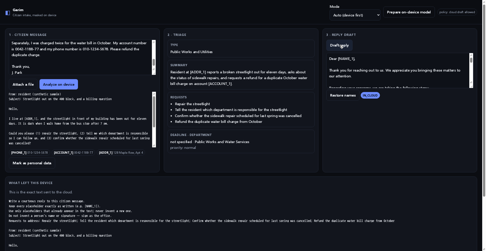

# Garim

**Hybrid AI for the public counter: citizen documents are redacted on the device, and only masked text can reach the cloud.**

Garim is a web app for the people who answer citizen messages for a living — municipal counters, welfare offices, school administration, hospital reception. Paste a complaint, and Garim redacts the personal data in your browser, triages the request (on the device first, in the cloud only when it has to), drafts a reply from masked text, and shows you the exact byte string that left the device.

- Live demo: **https://garim-hybrid-ai.web.app**
- Built with **Firebase AI Logic** (hybrid inference: Gemini Nano on-device + Gemini in the cloud), App Check, Remote Config, Authentication and Firestore, hosted on Firebase Hosting.



## What it does

1. **Intake** — paste a message, drop a `.txt`, or attach a photo of a paper complaint.
2. **Local redaction** — before any model runs, deterministic browser-side rules replace resident registration numbers, phone numbers, email addresses, bank accounts, plate numbers and street addresses with stable labels (`[RRN_1]`, `[PHONE_1]`, `[ADDR_1]`, …). The label → value mapping lives in the tab and is never sent or saved.
3. **Triage (hybrid)** — the masked text goes to the model with a structured-output schema: category, summary, a checklist of requests, deadline, suggested department, priority. `Auto` mode asks the on-device model first and falls back to the cloud; `Device-only` never calls the cloud.
4. **Reply draft** — only the masked text is sent. The cloud returns placeholders (`[ADDR_1]`), and **Restore names** puts the real values back locally, so the draft reads naturally while the cloud never held the personal data.
5. **Transparency inspector** — every result shows which side ran it (`ON_DEVICE` / `IN_CLOUD`, from the SDK's `inferenceSource`) and the latency, and the bottom panel shows *the exact text that left the device* — or states that nothing did.
6. **Policy switch** — Remote Config flags let an organisation force device-only operation: the draft button disappears and no request can leave the browser.

## How Firebase AI Logic is used

- `getAI(app, { backend: new GoogleAIBackend() })` — Gemini Developer API backend, no direct model API calls anywhere in the app.
- One routing policy per step: triage uses `InferenceMode.PREFER_ON_DEVICE` (or `ONLY_ON_DEVICE` in Device-only mode / strict policy), the draft uses `ONLY_IN_CLOUD`.
- One `Schema` for both paths: `inCloudParams.generationConfig.responseSchema` (with `responseMimeType: "application/json"`) and `onDeviceParams.promptOptions.responseConstraint`.
- `model.initializeDeviceModel(cb)` is only called from a user gesture (Chrome's activation rule), with a download-progress readout.
- `result.response.inferenceSource` drives the badge, the inspector wording, and the saved record.
- App Check is enforced for AI Logic (reCAPTCHA Enterprise / Fraud Defense on the hosted app).
- Remote Config (`policy_device_only`, `policy_cloud_draft_enabled`) is the policy channel; Firestore keeps only masked history for the anonymous user.

See [docs/architecture.md](docs/architecture.md) for the layer diagram and the privacy boundary.

## Run locally

```bash
git clone <this repo> && cd garim
cd app
cp firebase-config.example.js firebase-config.js   # fill in your own Firebase config + App Check site key
python3 -m http.server 5173                        # any static server works
# open http://localhost:5173 in desktop Chrome
```

On `localhost` the app uses a Firebase App Check **debug token**; the token is printed in the browser console. Register it in Firebase console → App Check → Apps → Manage debug tokens, and never commit it.

### Firebase project setup

1. Create a Firebase project (the free **Spark** plan is enough for text inference) and add a web app.
2. **AI Logic** → Get started → **Gemini Developer API**.
3. **App Check** → register the web app with **Fraud Defense (reCAPTCHA Enterprise)**, restricting the key to your domains, then enable App Check enforcement for AI Logic.
4. **Authentication** → enable **Anonymous**.
5. **Firestore** → create a database, then `firebase deploy --only firestore:rules`.
6. **Remote Config** → add `policy_device_only` (boolean, `false`) and `policy_cloud_draft_enabled` (boolean, `true`).

## Deploy

```bash
npm install -g firebase-tools
firebase login
firebase use <your-project-id>
firebase deploy --only hosting,firestore:rules
```

`firebase.json` publishes `app/` and applies `firestore.rules`.

## Testing the hybrid paths

| What to check | How |
| --- | --- |
| On-device inference really runs locally | Use desktop Chrome 139+ on supported hardware, enable `chrome://flags/#prompt-api-for-gemini-nano-multimodal-input`, restart, then **Prepare on-device model**. The badge reads `ON_DEVICE`; with the network disabled the triage step still completes. |
| The cloud path only gets masked text | On any other browser, **Analyze** falls back and the badge reads `IN_CLOUD`. The bottom panel shows the exact payload — search it for the original names/numbers and you will not find them. |
| Labels never leave the tab | **Mark as personal data** (select text, then mark) adds `[NAME_1]` and keeps the value in the tab. **Restore names** puts it back into the draft only. |
| Strict mode | Set `policy_device_only = true` in Remote Config and reload: the Draft button is disabled and the app refuses to send Korean text to the cloud. |
| App Check | Firebase console → App Check → APIs: AI Logic must show **Enforced**. |

Sample documents (synthetic) live in [`samples/`](samples/) — an English public-works complaint and a Korean welfare inquiry. No real citizen data exists anywhere in this project.

## Privacy model

- Redaction is **rules first and in the browser** — privacy does not depend on a model's judgement.
- The label ↔ value mapping is held in memory, never posted, never written to Firestore.
- Firestore stores only the masked text, the structured triage, the inference source and a timestamp, under the anonymous user's uid (`firestore.rules` restricts every read and write to that uid).
- `firebase-config.js` holds public client identifiers only (a web API key is not a secret); what protects the API is App Check. Debug tokens and service-account keys are never committed.
- The hosted build is free to use and requires no account.

## Limitations

- Chrome's on-device model does not support Korean, so Korean text takes the cloud path — after local redaction, with the payload shown first. The app says so instead of pretending.
- On-device inference is single-turn and capped at 9,216 tokens; long documents fall back to the cloud.
- Image input is accepted by the file picker but not yet sent to the model.
- Names are not detected automatically (Korean name detection over-flags); select and **Mark as personal data**.

## License

Apache License 2.0 — see [LICENSE](LICENSE).
